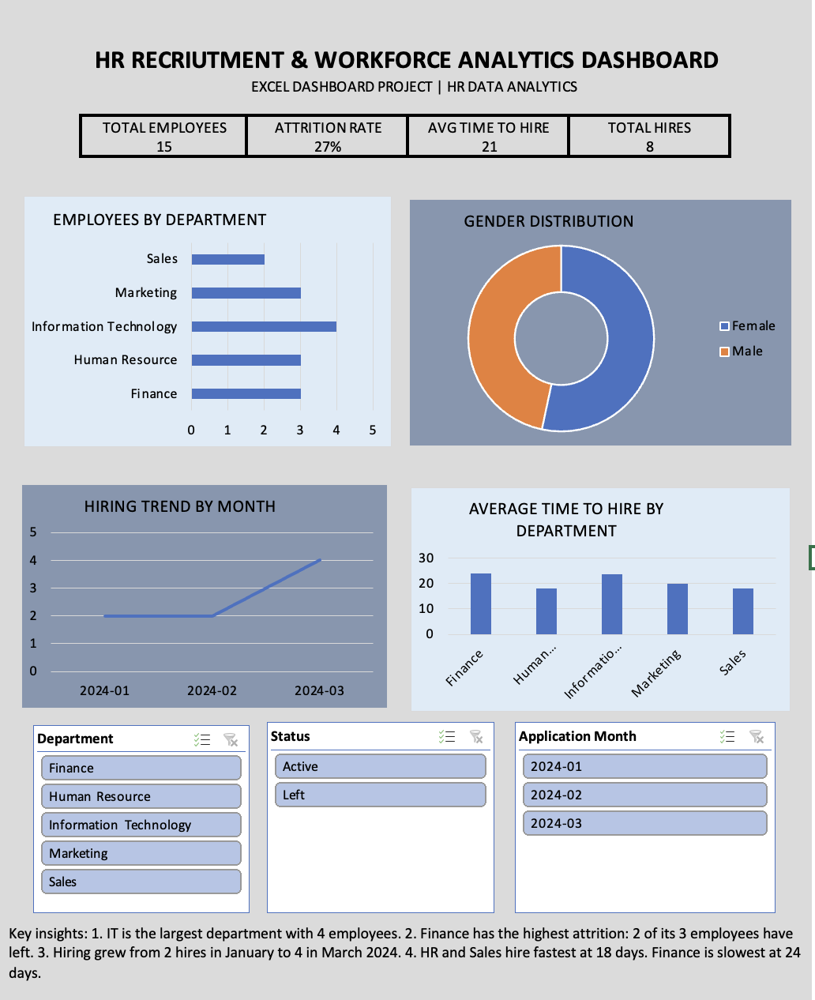
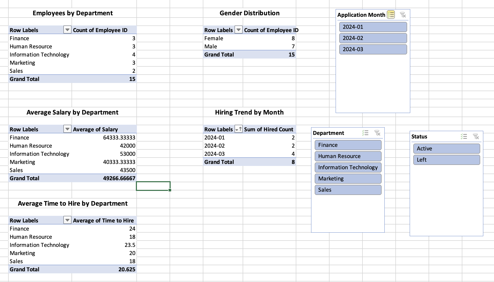

# HR Recruitment & Workforce Analytics Dashboard (Excel)



I built this dashboard to answer two questions an HR team asks all the time: how well is hiring going, and who is leaving? Working from simulated employee and recruitment data, I cleaned the data, built the calculations, and turned everything into an interactive Excel dashboard with KPI cards, charts and slicers.

## Why I built it

After five years in HR operations across Nigeria, the UK and Germany, I have seen how often decisions get made from gut feeling because the numbers sit in scattered spreadsheets. This project is my way of showing what that same data looks like when it is clean, connected and easy to read at a glance. It is also the first project in my HR data analytics portfolio.

## The scenario

An HR team in a company of 200 to 500 people has no clear view of recruitment performance or workforce trends. The task was to analyse the data and build one dashboard that gives them that visibility.

## What is in the workbook

`Didi_HR_Analytics_Dashboard.xlsx` has four sheets:

| Sheet | What it does |
|---|---|
| Employees | Cleaned employee data (15 employees) stored as an Excel Table called `EmployeeTable` |
| Recruitment | Cleaned candidate data (12 candidates) stored as `RecruitmentTable` |
| Pivots | Five pivot tables that feed every chart |
| Dashboard | The final interactive view |

## How I built it

**1. Cleaning the data.** I checked for duplicates, formatted every date as YYYY-MM-DD, handled the blank Hire Date and Exit Date cells, standardised department names, and converted both datasets into Excel Tables so formulas and pivots update automatically.

**2. Adding calculated columns.** In the Recruitment table I added Time to Hire (Hire Date minus Application Date), Application Month and Hired Count. In the Employees table I added Active Count and Left Count.

**3. Building pivot tables.** I created five pivots: Employees by Department, Gender Distribution, Average Salary by Department, Hiring Trend by Month, and Average Time to Hire by Department.



**4. Designing the dashboard.** Four KPI cards sit at the top, followed by four charts and three slicers (Department, Status and Application Month) that allow users to interact with and filter the dashboard. I kept it to a small colour palette so the numbers stay the focus.

## Key metrics

| Metric | Result |
|---|---|
| Total employees | 15 |
| Employees who left | 4 |
| Attrition rate | 26.7% |
| Total hires | 8 |
| Recruitment success rate | 66.7% (8 of 12 candidates) |
| Average time to hire | About 21 days |

## What the data shows

**IT is the biggest team.** It has 4 of the 15 employees, ahead of Finance, HR and Marketing at 3 each, and Sales at 2.

**Finance is where attrition is highest.** Two of its three employees have left, which is the main thing I would flag to HR leadership. Both Finance leavers were also among the highest paid in the dataset, so it would be worth understanding why.

**Hiring speed varies by department.** HR and Sales filled roles fastest at around 18 days, while Finance and IT took the longest at around 24 days.

**Hiring activity increased through the quarter.** The number of candidates who were eventually hired, grouped by their application month, was 2 in January, 2 in February and 4 in March 2024.

**The gender split is close to even.** 8 female and 7 male employees.

## Tools and skills

Excel Tables, calculated columns, PivotTables, slicers, KPI formulas (`COUNTA`, `SUM`, `AVERAGEIF`), charts, and conditional formatting for dashboard design. On the HR side: attrition analysis, time-to-hire and recruitment funnel reporting.

## A note on the data

The dataset is simulated and does not describe any real company or person. The numbers are small on purpose, so the focus stays on the method and the design rather than on the sample itself.

The attrition rate is calculated as the number of employees marked as Left divided by the total number of employee records (4 ÷ 15 = 26.7%). This is a simplified overall attrition measure rather than a period-specific annual attrition rate.

## Repository contents

```
README.md
Didi_HR_Analytics_Dashboard.xlsx
Screenshots/
    dashboard.png
    pivot-tables.png
```

## What I would do next

I rebuilt the same analysis in Power BI to compare how both tools handle the same data. You can find that project here: [People Analytics & Workforce Insights Dashboard (Power BI)](https://github.com/Akambella/People-Analytics-Workforce-Insights-Dashboard).

---

Built by Didi (Edidiong Akama), Berlin. MSc Information Technology Management student with a background in HR operations and workforce reporting.
